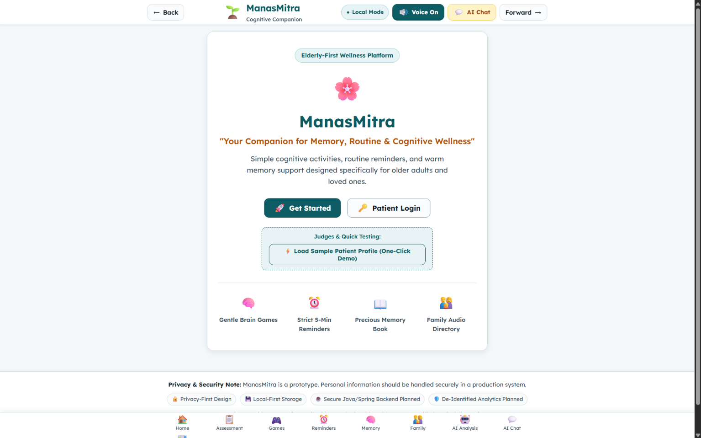
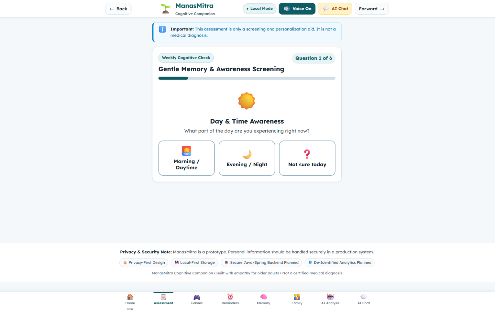
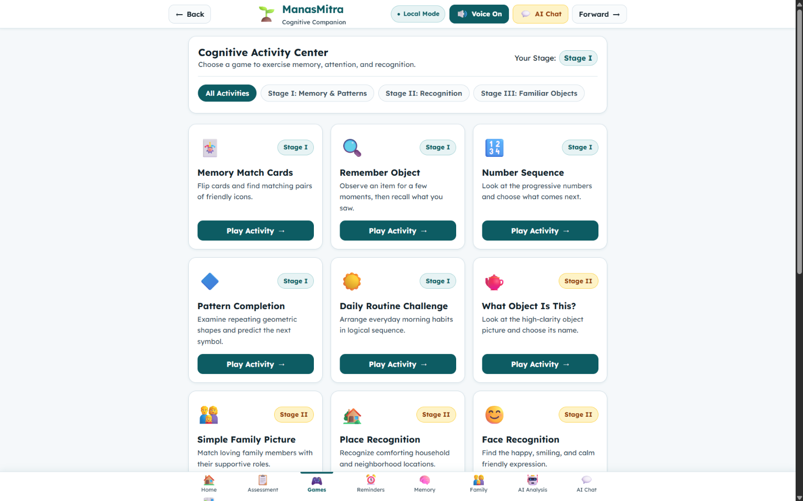
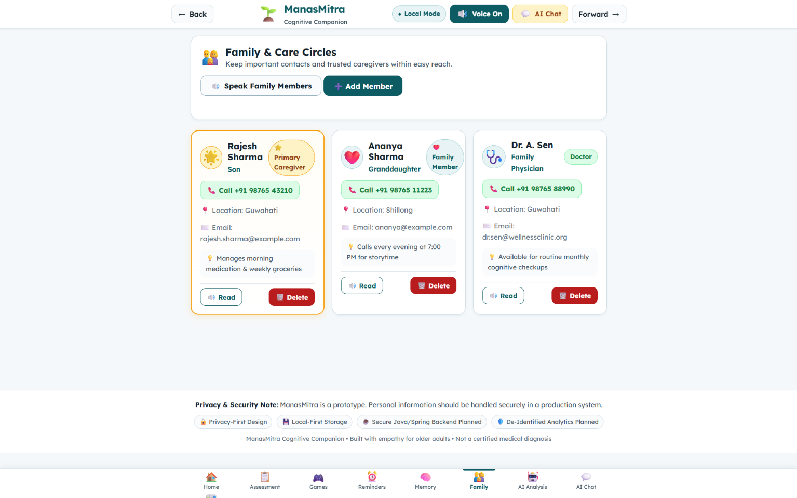
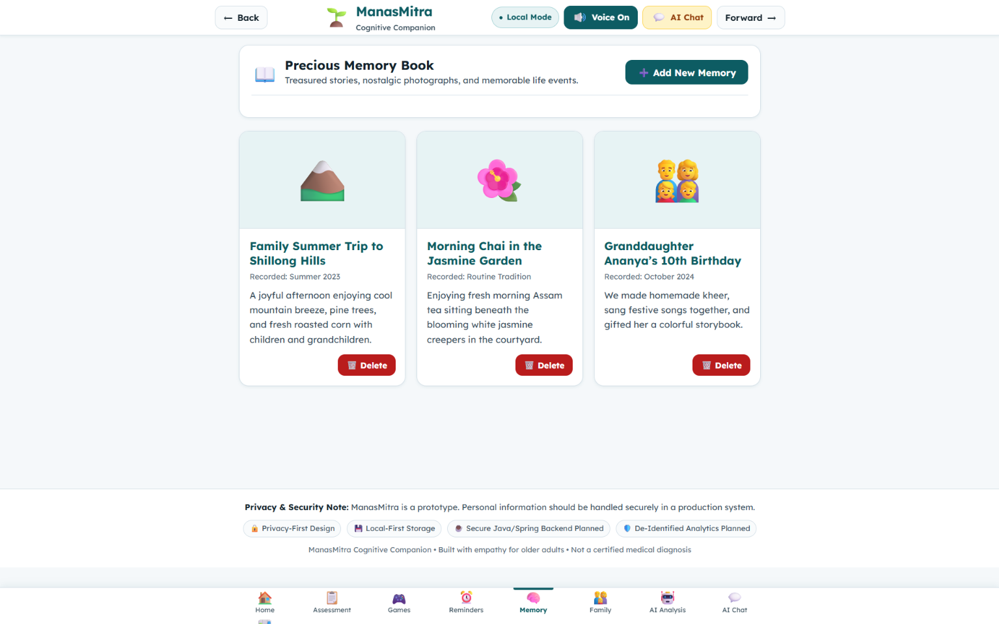
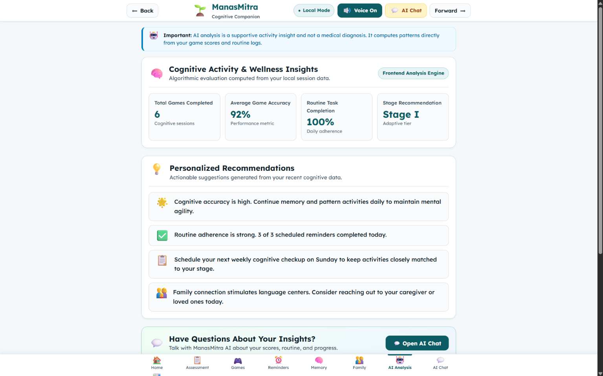
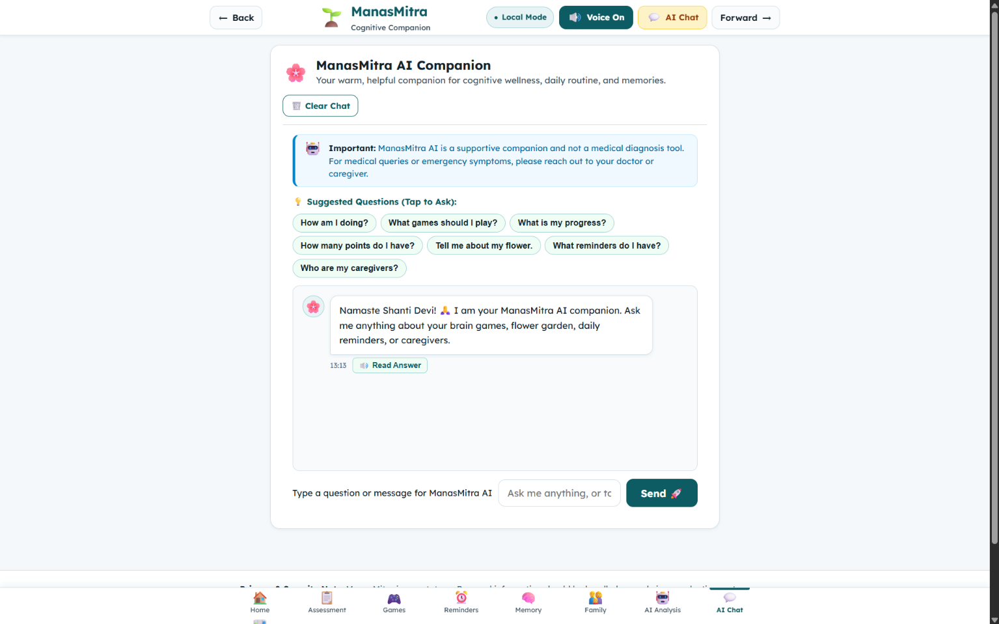

# 🌱 ManasMitra – Cognitive Wellness & Routine Companion

### An Elderly-First Cognitive Wellness Platform

ManasMitra is a web-based cognitive wellness companion designed to support older adults through interactive brain activities, memory preservation, daily routine reminders, family connections, and personalized activity insights.

The platform provides a simple and accessible interface that helps older adults stay engaged with everyday cognitive activities while allowing caregivers and family members to remain connected.

> **Disclaimer:** ManasMitra is a supportive wellness prototype, not a medical diagnosis or treatment tool.

---

## ✨ Key Features

### 🏠 1. Home Dashboard
- Simple and accessible user interface.
- Patient login and sample profile demonstration.
- Navigation across all application modules.

### 🧠 2. Cognitive Assessment
- Weekly cognitive screening flow.
- Six-question assessment.
- Stage-based activity personalization.
- Progress tracking.

### 🎮 3. Cognitive Games
- Memory Match Cards.
- Remember Object.
- Number Sequence.
- Pattern Completion.
- Daily Routine Challenge.
- Additional recognition and memory activities.

### ⏰ 4. Daily Routine Reminders
- Create and manage daily reminders.
- Track completed routine activities.
- Snooze and reminder status management.

### 📖 5. Precious Memory Book
- Save memorable life events.
- Store personal stories and descriptions.
- Preserve meaningful memories.

### 👨‍👩‍👧 6. Family & Care Circles
- Manage family member information.
- Maintain caregiver contact details.
- Display important support contacts.

### 🤖 7. AI Companion
- Chat-style companion interface.
- Suggested questions.
- Voice-enabled responses where supported.

### 📊 8. Cognitive Activity & Wellness Insights
- Game performance tracking.
- Average accuracy calculation.
- Routine completion monitoring.
- Personalized activity recommendations.

---

## 🛠️ Technologies Used

| Component | Technology |
|---|---|
| Frontend | HTML5 |
| Styling | CSS3 |
| Frontend Logic | JavaScript (ES6+) |
| Backend | Python 3 |
| Database | SQLite |
| API | REST API |
| Browser Storage | LocalStorage |
| Voice Support | Web Speech API |

---

## 🏗️ Project Architecture

ManasMitra follows a frontend-backend architecture.

1. **Frontend:** HTML, CSS and JavaScript provide the user interface and application functionality.
2. **Backend:** Python handles API requests and database operations.
3. **Database:** SQLite stores patient profiles, assessments, game scores, reminders, family information and memories.
4. **Local Storage:** Browser LocalStorage supports local-first application functionality.

---

## 📸 Application Screenshots

### Home Dashboard


### Cognitive Assessment


### Cognitive Games


### Family & Care Circles


### Precious Memory Book


### AI Analysis


### AI Companion Chat


---

## 🚀 Running the Project Locally

### Prerequisites
- Python 3
- Visual Studio Code (recommended)
- Modern web browser

### Step 1: Clone the Repository

```bash
git clone https://github.com/YOUR-USERNAME/ManasMitra.git
```

### Step 2: Open the Project

```bash
cd ManasMitra
```

### Step 3: Initialize the Database

```bash
python db_setup.py
```

This creates the SQLite database using the schema and sample data.

**Note:** Running this script recreates the database and removes existing database contents.

### Step 4: Start the Backend

```bash
python server.py
```

### Step 5: Open the Application

Visit:

```text
http://127.0.0.1:8000/
```

The application will now run locally.

---

## 🧪 Testing

Run the backend first, then execute:

```bash
python test_api.py
```

This tests the REST API endpoints and database functionality using the sample data.

---

## 🔒 Privacy & Security

- Designed with a privacy-first approach.
- Local-first data storage support.
- Sample data is used for demonstration.
- The application is a prototype and requires additional security and privacy measures before production deployment.

---

## 🔮 Future Enhancements

- Secure cloud-based database integration.
- Improved caregiver and patient authentication.
- Enhanced accessibility features.
- Secure data synchronization.
- Expanded cognitive activities and progress analytics.

---

## ⚠️ Important Limitations

- The Python backend currently runs locally.
- GitHub Pages can host the static frontend but cannot run the Python backend.
- Browser voice functionality depends on browser support.
- This prototype does not provide medical diagnosis or treatment.

---

## 👨‍💻 Project

**ManasMitra – Cognitive Wellness & Routine Companion**

Developed as a technology project focused on supporting older adults and improving everyday cognitive engagement through accessible digital experiences.
